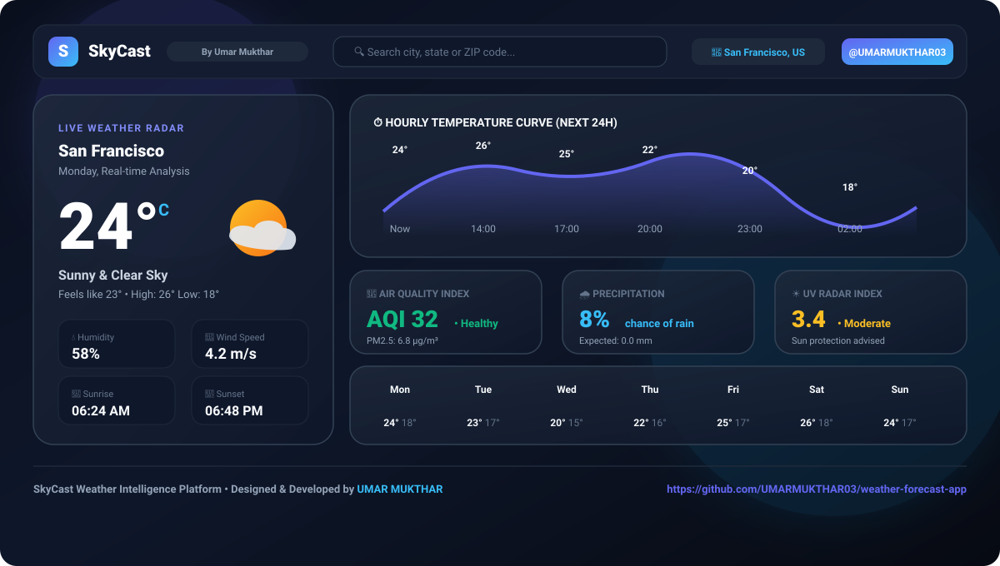

<div align="center">

# 🌤️ SkyCast — Real-Time Weather Intelligence

**Designed & Built by [UMAR MUKTHAR](https://github.com/UMARMUKTHAR03)**

[](https://umarmukthar03.github.io/weather-forecast-app/)
[](https://github.com/UMARMUKTHAR03)
[](LICENSE)

<br/>

<!-- Interactive High-Res Interface Preview directly inside GitHub Repo -->


</div>

---

## 🌟 Live Demo & Web App

- 🌐 **Live Website Link:** [https://umarmukthar03.github.io/weather-forecast-app/](https://umarmukthar03.github.io/weather-forecast-app/)
- 👨‍💻 **Creator / Maintainer:** [Umar Mukthar (@UMARMUKTHAR03)](https://github.com/UMARMUKTHAR03)
- 📦 **Repository:** [UMARMUKTHAR03/weather-forecast-app](https://github.com/UMARMUKTHAR03/weather-forecast-app)

---

## 🚀 Key Highlights & Architectural Features

- **Atmospheric Metric Intelligence:** High-precision telemetry for temperature, feels-like humidity, barometric pressure, wind trajectory, sunrise & sunset tracking.
- **Hourly Forecast Curves:** 24-hour predictive trend analysis with localized timezone conversion.
- **Air Quality & Pollution Monitoring (AQI):** Detailed particulate tracking including PM2.5, PM10, CO, NO2, and Ozone concentration.
- **Precipitation Probability & UV Index:** Visual chance-of-rain forecasts with UV radiation safety levels.
- **Global Search & Geocoding:** Auto-completion across worldwide municipalities.
- **Adaptive Ambient Theme Engine:** Frosted glass cards, glowing dark-mode aesthetics, and smooth responsive layout.

---

## 🛠️ Technology Stack

- **Frontend:** React 18, Vite, JavaScript (ESNext)
- **State Architecture:** Redux Toolkit (RTK Query for asynchronous caching)
- **Design System:** Tailwind CSS, Heroicons, React Icons, Headless UI
- **Visuals & Maps:** Chart.js, Leaflet Interactive Maps
- **Data Providers:** OpenWeather API, Open-Meteo, Google Places API

---

## 💻 Local Installation & Setup

1. **Clone the repository:**
   ```bash
   git clone https://github.com/UMARMUKTHAR03/weather-forecast-app.git
   cd weather-forecast-app
   ```

2. **Install project dependencies:**
   ```bash
   npm install
   ```

3. **Configure Environment Keys:**
   Create a `.env` file in the root directory:
   ```env
   VITE_API_KEY_OPENWEATHERMAP=your_api_key_here
   ```

4. **Run the local development server:**
   ```bash
   npm run dev
   ```

5. **Build optimized production bundle:**
   ```bash
   npm run build
   ```

---

## 👤 Author & Attribution

**UMAR MUKTHAR**
- **GitHub:** [@UMARMUKTHAR03](https://github.com/UMARMUKTHAR03)
- **Profile:** [https://github.com/UMARMUKTHAR03](https://github.com/UMARMUKTHAR03)
- **Specialization:** AI Engineering | Machine Learning | Full-Stack Development

---

## 📄 License

This repository is licensed under the [MIT License](LICENSE) &copy; 2026 **UMAR MUKTHAR**.
